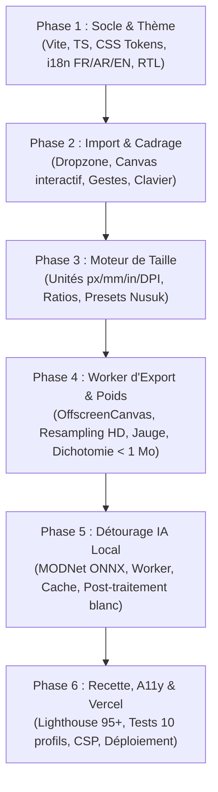

# Cahier des Charges & Spécifications Techniques : « Nusuk Photo »
**Application web client-side de recadrage et mise en conformité de photos d'identité pour Hajj & Umrah (hajj.nusuk.sa)**

---

## 1. Vision et Objectifs du Projet

### 1.1 Contexte & Problématique
Le portail officiel du Hajj et de la Omra (**hajj.nusuk.sa**) impose des spécifications photographiques très strictes pour la validation des visas et des cartes d'identité de pèlerin (Nusuk Card) :
- Dimensions requises : **480 × 640 px** par défaut (format portrait normalisé pour photo d'identité).
- Fond obligatoire : **Blanc pur (#FFFFFF)**, uniforme, sans ombres ni dégradés.
- Poids strict du fichier : **Inférieur ou égal à 1 Mo (1 000 000 octets)** sous peine de rejet immédiat lors de la soumission du formulaire.
- Cadrage biométrique : Visage droit, centré, proportions respectées, regard vers l'objectif.

La majorité des pèlerins et agences utilisent des smartphones récents produisant des clichés de 12 à 48 Mpx pesant entre 3 et 15 Mo, sur des arrière-plans encombrés.

### 1.2 Solution : « Nusuk Photo »
Une application web monopage (SPA) ultra-rapide, **100 % exécutée côté client**, permettant en quelques secondes de :
1. Importer un portrait depuis n'importe quel appareil (ordinateur, smartphone).
2. Supprimer automatiquement l'arrière-plan grâce à une IA embarquée et le remplacer par un blanc pur `#FFFFFF`.
3. Cadrer, orienter et ajuster l'image à l'aide d'un guide biométrique ovale conforme.
4. Resampler et exporter un fichier JPEG ou PNG garanti **≤ 1 000 000 octets** et exactement aux dimensions exigées.

### 1.3 Principes Directeurs
- **Confidentialité absolue (« Zero-Knowledge / Air-Gapped by Design »)** : Aucune image, aucune métadonnée, aucun octet n'est jamais transmis à un serveur tiers ou cloud. Le traitement s'effectue intégralement dans la mémoire vive de l'appareil.
- **Autonomie & Zéro Dépendance Externe** : Aucun appel vers un CDN externe au runtime. Polices, runtime WebAssembly et modèles d'IA sont auto-hébergés.
- **Robustesse Mobile** : Gestion stricte des allocations mémoire (`OffscreenCanvas`, libération des `ImageBitmap`) pour fonctionner sans crash sur iOS Safari et Chrome Android même avec des photos sources de 24 Mpx.

---

## 2. Architecture Technique & Déploiement

### 2.1 Stack Technologique
| Composant | Technologie retenue | Justification |
| :--- | :--- | :--- |
| **Bundler & Outillage** | Vite + TypeScript | Build ultra-rapide, typage strict, tree-shaking optimal |
| **Interface Utilisateur** | Preact (ou Vanilla TS optimisé) | Empreinte minimale (< 4 Ko gzippé), réactivité native |
| **Inférence IA** | `@huggingface/transformers` (WASM / WebGL) | Inférence locale du modèle MODNet dans un Web Worker |
| **Traitement Graphique** | `OffscreenCanvas` + Web Workers | Rendu et encodage asynchrones sans aucun gel de l'UI |
| **Hébergement** | Vercel (Plan Hobby Statique) | Déploiement edge statique, budget strict < 100 Mo d'assets |

### 2.2 Configuration Vercel & Sécurité (`vercel.json`)
L'application est servie avec une politique de sécurité de contenu (CSP) stricte interdisant formellement toute fuite réseau :

```json
{
  "headers": [
    {
      "source": "/(.*)",
      "headers": [
        {
          "key": "Content-Security-Policy",
          "value": "default-src 'self'; img-src 'self' blob: data:; worker-src 'self' blob:; script-src 'self' 'wasm-unsafe-eval'; style-src 'self' 'unsafe-inline'; font-src 'self'; connect-src 'self';"
        },
        {
          "key": "X-Content-Type-Options",
          "value": "nosniff"
        },
        {
          "key": "X-Frame-Options",
          "value": "DENY"
        },
        {
          "key": "Referrer-Policy",
          "value": "no-referrer"
        }
      ]
    },
    {
      "source": "/(models|vendor)/(.*)",
      "headers": [
        {
          "key": "Cache-Control",
          "value": "public, max-age=31536000, immutable"
        }
      ]
    }
  ]
}
```

### 2.3 Budget d'Assets Statiques (< 100 Mo)
Pour respecter le quota des déploiements Vercel Hobby :
- Modèle IA unique : **MODNet ONNX quantifié INT8** (~25 Mo) stocké sous `/public/models/modnet/`.
- Runtime ONNX WebAssembly : Binaires optimisés sous `/public/vendor/ort/` (`ort-wasm-simd-threaded.wasm`, ~12 Mo).
- Polices de caractères locales : Fichiers WOFF2 sous `/public/fonts/` (`Inter` pour les chiffres/latin, `Tajawal` pour l'arabe, ~150 Ko total).

---

## 3. Écran d'Accueil (Ingestion & Drag-and-Drop)

### 3.1 Zone de Dépôt Principale (Dropzone)
- **Positionnement** : Centrée sur l'écran d'accueil, avec bordure pointillée dynamique (dash pattern).
- **Modes d'ingestion multiples** :
  1. **Glisser-Déposer** de fichiers avec détection du drag-over (surbrillance verte `#006C35`, léger agrandissement d'échelle 1.02x).
  2. **Clic standard** ouvrant le sélecteur natif de fichiers de l'OS.
  3. **Capture Mobile Directe** via balise `<input type="file" accept="image/*" capture="user">` pour prise de vue instantanée en caméra frontale ou arrière.
  4. **Presse-papier global** : Écouteur d'événement `window.addEventListener('paste', ...)` permettant de coller directement une capture d'écran ou une image copiée (`Cmd+V` / `Ctrl+V`).

### 3.2 Formats & Validations
- Formats acceptés : **JPEG / JPG, PNG, WebP**.
- Validation double niveau :
  - Niveau 1 : Attributs MIME types acceptés.
  - Niveau 2 : Contrôle des octets magiques (Magic Bytes) en tête de fichier pour rejeter les fichiers corrompus ou renommés frauduleusement.
- Limite de sécurité en entrée : Fichiers plafonnés à 30 Mo pour prévenir les plantages de mémoire vive sur téléphones d'entrée de gamme.

### 3.3 États de l'Interface
- **Repos** : Illustration épurée, icône d'appareil photo, consigne multilingue claire.
- **Survol (Hover / Drag-over)** : Halo émeraude, bordure continue renforcée.
- **Chargement (Processing initial)** : Affichage d'un squelette animé (skeleton loader) pendant l'extraction EXIF et la création de l'aperçu de travail.
- **Erreur** : Notification contextuelle immédiate en cas de format invalide, fichier illisible ou dimensions nulles.

### 3.4 Ambiance Visuelle & Transition
- Arrière-plan orné d'un motif géométrique islamique discret en SVG vectoriel (opacité subtile : 3 % en mode clair, 5 % en mode sombre).
- Message de rassurance permanent : « *🔒 Vos photos ne quittent jamais votre appareil — Traitement 100% privé* ».
- Transition fluide vers le dashboard de travail : fondu et glissement en ~300 ms (automatiquement neutralisé si l'utilisateur a activé `prefers-reduced-motion: reduce`).

---

## 4. Dashboard de Retouche & Cadrage

### 4.1 Ergonomie & Responsive Layout
- **Grand Écran / Bureau (≥ 1024 px)** :
  - **Zone gauche (65 % de l'écran)** : Espace de cadrage interactif haute visibilité.
  - **Zone droite (35 % de l'écran)** : Panneau de réglages sous forme de cartes structurées (Taille, Fond, Export).
  - **Barre d'action inférieure fixe** : Visualisation instantanée du format, de la jauge de conformité de poids, et bouton principal de téléchargement.
- **Écran Mobile (< 1024 px)** :
  - **Partie supérieure** : Viewport de cadrage tactile optimisé pour la manipulation aux doigts.
  - **Partie inférieure** : Panneau coulissant (Bottom Sheet) organisé en onglets clairs : `[ Dimensions ]` · `[ Fond ]` · `[ Export ]`.

```
+------------------------------------------------------------------------------------+
|  [Logo Nusuk Photo]     [FR | العربية | EN]                         [Thème Clair/Sombre]  |
+---------------------------------------------------+--------------------------------+
|                                                   |  CARTE 1 : TAILLE DE SORTIE   |
|                                                   |  Préréglages : [Nusuk] [35x45] |
|              ZONE DE CADRAGE                      |  L: [ 480 ] px   H: [ 640 ] px |
|                                                   |  [x] Verrouiller le ratio      |
|         +-----------------------+                 +--------------------------------+
|         |       CADRE FIXE      |                 |  CARTE 2 : FOND & DÉTOURAGE    |
|         |  (Guide visage ovale) |                 |  [O] Détourage IA (Actif)      |
|         |                       |                 |  Lissage bords : [---o------]  |
|         +-----------------------+                 |  [ Maintenir pour comparer ]   |
|                                                   +--------------------------------+
|  Contrôles rapides :                              |  CARTE 3 : EXPORT & FORMAT     |
|  [ - ] [ Zoom: 125% ] [ + ] [ Centrer ] [ 90° ]   |  (o) JPG [Recommandé]   ( ) PNG|
|                                                   |  Qualité auto : 0.92           |
+---------------------------------------------------+--------------------------------+
|  BARRE BASSE :  480 x 640 px  |  JAUGE : [======    ] 412 Ko / 1 Mo  |  [ TÉLÉCHARGER ] |
+------------------------------------------------------------------------------------+
```

---

### 4.2 Moteur de Cadrage Interactif

#### A. Principe du Cadre Fixe
- Le cadre de recadrage reste **fixe et centré** dans le viewport, son ratio d'aspect s'adaptant dynamiquement à la taille de sortie demandée.
- L'image de l'utilisateur se positionne, se déplace et se redimensionne **en dessous** du cadre.
- **Zone active retenue** : Image parfaitement visible, grille de composition des tiers en surimpression légère, repères d'angles discrets.
- **Zone exclue** : Recouverte d'un masque semi-transparent sombre (opacité 55 %).
- **Guide Biométrique Ovale** (activable / désactivable) : Silhouette translucide matérialisant l'ovale du visage (normes ICAO 9303 / ISO 19794-5) pour garantir un positionnement parfait des yeux et du menton.

#### B. Contrôles & Gestuelle
- **Souris & Trackpad** :
  - Clic gauche enfoncé + glisser pour déplacer (pan).
  - Molette / molette trackpad pour zoomer en continu (centré sur le curseur).
- **Écrans Tactiles** :
  - Déplacement à un doigt.
  - Pincement à deux doigts (pinch-to-zoom) fluide.
- **Clavier (Accessibilité AA)** :
  - Touches fléchées : Déplacement précis de 1 pixel par frappe.
  - `Maj` + Touches fléchées : Déplacement rapide de 10 pixels par frappe.
  - Touches `+` / `-` : Incréments de zoom de 5 %.
- **Boutons d'action rapide** :
  - `Zoom −` / `Zoom +` et curseur de zoom linéaire.
  - `Centrer` : Recentrage immédiat au milieu du cadre.
  - `Ajuster (Fit)` : Redimensionne l'image pour qu'elle tienne entièrement dans le cadre.
  - `Remplir (Fill)` : Agrandit l'image pour combler entièrement le cadre.
  - `Rotation 90°` : Rotation horaire par pas de 90°.
  - `Miroir` : Inversement horizontal (flip X).
  - `Réinitialiser` : Remise à zéro de toutes les transformations.

#### C. Modèle Mathématique Normalisé
L'état de transformation est stocké sous forme de coordonnées relatives normalisées indépendantes de la résolution d'affichage :
$$\text{Transformation} = \{ \text{scale}: \mathbb{R}^+, \text{tx}: \mathbb{R}, \text{ty}: \mathbb{R}, \text{rotation}: \{0, 90, 180, 270\}, \text{flipX}: \text{boolean} \}$$
*Avantage* : Si l'utilisateur modifie la résolution de sortie (ex: passe de 480×640 à 35×45 mm), sa composition et son cadrage visuel sont scrupuleusement conservés sans déformation.

#### D. Détection des Zones Non Couvertes
Si l'image transformée ne couvre pas la totalité du rectangle de sortie, un bandeau informatif discret apparaît :
> « *Les zones vides autour de la photo seront automatiquement remplies en blanc pur.* »

---

### 4.3 Taille de Sortie & Unités

#### A. Préréglages en 1 Clic
1. **Nusuk Hajj / Omra (Par défaut)** : `480 × 640 px`
2. **Format Standard Passeport / Visa** : `35 × 45 mm` (à 300 DPI $\rightarrow 413 \times 531 \text{ px}$)
3. **Format International 2×2 pouces** : `51 × 51 mm` (à 300 DPI $\rightarrow 602 \times 602 \text{ px}$)

#### B. Saisie Personnalisée & Conversion d'Unités
- Champs numériques pour **Largeur** et **Hauteur**.
- Sélecteur d'unité : `px`, `mm`, `cm`, `in`.
- Champ **DPI** (résolution par pouce, fixée par défaut à **300 DPI**), visible et ajustable dès qu'une unité physique est sélectionnée.
- Formules de conversion strictes avec arrondi à l'entier le plus proche :
  $$\text{px} = \text{round}\left( \text{valeur}_{\text{in}} \times \text{DPI} \right)$$
  $$\text{valeur}_{\text{in}} = \frac{\text{valeur}_{\text{mm}}}{25.4} = \frac{\text{valeur}_{\text{cm}}}{2.54}$$
- Bouton de verrouillage du ratio d'aspect (cadenas).
- Affichage permanent du résultat converti en pixels sous les champs : `→ 480 × 640 px`.
- Bornes de sécurité : Largeur et hauteur bornées entre **50 px** et **4000 px**.

---

### 4.4 Fond & Détourage Automatique par IA

- **Fond imposé** : Blanc pur `#FFFFFF` (non modifiable, exigence stricte de la plateforme Nusuk).
- **Interrupteur « Supprimer l'arrière-plan (IA) »** :
  - Déclenche le détourage local instantané du portrait via le modèle de vision.
- **Réglage « Adoucir les contours »** : Curseur de lissage (feathering) de 0 à 2.0 px pour éliminer l'effet d'escalier ou les arêtes tranchantes sur les cheveux et vêtements.
- **Comparaison Avant / Après** :
  - Bouton interactif « Maintenir pour voir l'original » permettant de basculer instantanément entre la version détourée et la photo brute pour contrôle visuel.
- **Bouton « Rétablir la photo d'origine »** : Désactive l'effet et libère le masque mémoire.
- **Avertissement de conformité** :
  > « *Veuillez vérifier la netteté des contours (cheveux, voile, ghutra) avant de télécharger.* »

---

### 4.5 Système d'Export & Contrôle Strict du Poids (< 1 Mo)

#### A. Limite Imposée par le Portail Nusuk : 1 000 000 Octets
- Constante système : `MAX_BYTES = 1_000_000` octets.
  *(Lecture prudente et sécurisée de « 1 Mo », garantissant que le fichier passera quel que soit le mode de calcul du serveur Nusuk, en base décimale $10^6$ ou binaire $2^{20}$).*
- Champ expert accessible : « *Seuil personnalisé (Ko)* », initialisé à 1000 Ko.

#### B. Mesure Temps Réel du Poids Réel (Encoding Worker)
- **Déclenchement asynchrone** : Après chaque manipulation de cadrage, changement de dimension ou de qualité (avec **debounce de 300 ms**).
- **Encodage effectif** : Réalisé en arrière-plan dans le Web Worker sur un `OffscreenCanvas`.
- **Zéro estimation mathématique** : Le poids affiché est le poids physique réel en octets du Blob généré.
- **Annulation proactive (`AbortController`)** : Si une nouvelle action survient pendant qu'un encodage est en cours, le calcul précédent est immédiatement interrompu pour préserver le CPU.

#### C. Jauge Trichrome de Conformité
Présente simultanément dans la carte « Export » et dans la barre d'action basse :
- 🟢 **Vert (< 800 Ko / < 80 %)** : Conforme, marge de sécurité excellente.
- 🟠 **Orange (800 Ko à 1000 Ko / 80 % à 100 %)** : Conforme mais proche de la limite.
- 🔴 **Rouge (> 1000 Ko / > 100 %)** : **Non conforme**, rejet certain par le portail Nusuk.

#### D. Stratégie Format JPG (Format par défaut - Badge « Recommandé »)
- Qualité initiale fixée à **0.95** (curseur manuel disponible de 0.70 à 1.00).
- **Ajustement automatique par dichotomie (Binary Search)** :
  Si l'encodage à 0.95 produit un fichier $> 1\,000\,000$ octets :
  1. Le Worker exécute une recherche dichotomique sur le paramètre de qualité JPEG entre **0.70** et **0.95** (précision : pas de 0.01, maximum 5 itérations).
  2. Sélection de la qualité la plus haute possible garantissant $\text{Poids} \le 1\,000\,000\text{ octets}$.
  3. Affichage d'une notification explicite : « *Qualité ajustée automatiquement à 0.88 pour respecter la limite de 1 Mo.* »
- **Cas extrême** : Si même à la qualité minimale de 0.70 le fichier dépasse 1 Mo (cas d'une résolution personnalisée gigantesque très bruitée), un message d'aide suggère de réduire les dimensions en pixels.

#### E. Stratégie Format PNG (Compression Sans Perte)
- Format sans perte (lossless), aucun curseur de qualité.
- **Règle d'or** : Ne jamais altérer ou dégrader un PNG en douce (pas de réduction forcée de palette 8-bits non sollicitée).
- **Gestion du dépassement** :
  Si le PNG dépasse 1 000 000 octets :
  - Affichage d'un bandeau d'alerte bien visible : « *Ce fichier PNG pèse plus de 1 Mo et sera refusé par Nusuk.* »
  - Deux boutons d'action proposés :
    - Bouton primaire d'action corrective : « **Passer en JPG (Recommandé)** ».
    - Bouton secondaire : « **Télécharger quand même le PNG** ».

#### F. Pipeline de Rendu Haute Définition
1. **Source HD** : Chargement direct du buffer source en pleine résolution avec orientation EXIF corrigée nativement via `createImageBitmap(source, { imageOrientation: 'from-image' })`.
2. **Buffer de sortie** : Allocation du canevas aux dimensions exactes demandées.
3. **Fond blanc** : Remplissage intégral du rectangle en `#FFFFFF`.
4. **Transformations affines** : Application de la matrice (translation, scale, rotation, miroir).
5. **Algorithme de réduction (Downsampling)** :
   Pour éviter l'aliasing et le crénelage lors du passage d'une photo 24 Mpx à 640×480 px, exécution d'une réduction progressive par paliers successifs de division par 2 (halving step-down), suivie d'un échantillonnage final avec `imageSmoothingQuality = "high"`.
6. **Suppression des métadonnées** : L'encodage via `toBlob()` ou `convertToBlob()` élimine structurellement toutes les balises EXIF, coordonnées GPS, métadonnées d'appareil photo et horodatages.
7. **Nommage standardisé du fichier généré** :
   ```
   photo-nusuk-{Largeur}x{Hauteur}.{extension}
   Exemple : photo-nusuk-480x640.jpg
   ```

---

## 5. Moteur de Détourage par IA Embarquée

### 5.1 Modèle Sélectionné & Runtime Local
- **Modèle** : `Xenova/modnet` (licence libre Apache-2.0, entraîné pour les portraits et la séparation fine des mèches de cheveux).
- **Format** : Modèle ONNX quantifié (INT8) pour un compromis idéal : taille de téléchargement ~25 Mo, consommation mémoire contenue (< 120 Mo en inférence), exécution fluide sur CPU/WASM ou WebGL.
- **Configuration hermétique 100 % locale** :
  ```typescript
  import { env } from '@huggingface/transformers';

  env.allowRemoteModels = false;
  env.localModelPath = '/models/';
  env.backends.onnx.wasm.wasmPaths = '/vendor/ort/';
  ```

### 5.2 Abstraction par Interface (`Strategy Pattern`)
Pour permettre l'interchangeabilité future du modèle (ex: RMBG-1.4, BiRefNet) sans modifier le cœur de l'application, l'accès au modèle est encapsulé :

```typescript
export interface BackgroundRemover {
  init(onProgress?: (percent: number) => void): Promise<void>;
  remove(bitmap: ImageBitmap): Promise<ImageBitmap>;
  terminate(): void;
}
```

### 5.3 Algorithme de Post-Traitement du Masque Alpha
L'inférence produit un masque matting en niveaux de gris ($[0, 255]$). Pour garantir une photo d'identité sans artéfacts :
1. **Redimensionnement bicubique** du masque produit par le réseau de neurones aux dimensions natives de l'image originale.
2. **Érosion et lissage gaussien paramétrable** (0 à 2 px) pour éliminer les halos de l'ancien décor.
3. **Décontamination des couleurs de bordure (Color Decontamination)** : Neutralisation des pixels de frange pour éviter qu'un fond sombre ou vert d'origine ne laisse un liseré disgracieux sur les contours du visage ou des habits blancs (Ihram).
4. **Fusion sur fond blanc pur** selon la formule de composition alpha :
   $$\text{Pixel}_{\text{final}} = \text{Pixel}_{\text{source}} \times \alpha + 255 \times (1 - \alpha)$$

### 5.4 Expérience Utilisateur (UX) du Moteur IA
- **Premier chargement** : Barre de progression animée avec libellé explicite : « *Téléchargement du modèle de détourage (une seule fois, ~25 Mo)...* ».
- **Mise en cache pérenne** : Stockage du modèle dans le Cache Storage du navigateur (`caches.open()`) ; les visites ultérieures démarrent instantanément, y compris sans connexion Internet.
- **Mise en cache du masque calculé** : Une fois la photo détourée, modifier le cadrage, la taille ou la rotation réutilise le masque en mémoire sans recalculer l'inférence neuronale.
- **Gestion des pannes (Graceful Degradation)** : Si le périphérique ne supporte pas WebAssembly ou manque de mémoire, un message bienveillant s'affiche, le module IA est désactivé et l'utilisateur conserve l'intégralité des fonctions de recadrage manuel.

---

## 6. Design System & Identité Visuelle

L'interface adopte une esthétique sobre, haut de gamme et institutionnelle, inspirée de l'identité officielle de la plateforme Nusuk et du Ministère du Hajj et de la Omra.

### 6.1 Tokens de Couleurs

| Jeton Sémantique | Mode Clair | Mode Sombre | Utilisation |
| :--- | :--- | :--- | :--- |
| `--bg-app` | `#F6F8F6` | `#0C1511` | Fond global de la page |
| `--bg-surface` | `#FFFFFF` | `#14211A` | Cartes, panneaux, boîte de dialogue |
| `--bg-surface-elevated`| `#FFFFFF` | `#1A2A22` | Popovers, barres flottantes |
| `--text-primary` | `#10231A` | `#E8F1EB` | Titres, valeurs principales |
| `--text-secondary` | `#52665B` | `#9BB3A4` | Libellés, unités, aides |
| `--primary` | `#006C35` | `#3DBE7A` | Vert Nusuk officiel, actions principales |
| `--primary-hover` | `#00552A` | `#4CD48B` | État survol des boutons |
| `--primary-soft` | `#E3F1E8` | `#1B2E23` | Badges, fonds d'onglets sélectionnés |
| `--accent-gold` | `#C49A45` | `#D8B263` | Accents de distinction, pictogrammes |
| `--border-color` | `#D7E3DB` | `#243629` | Bordures de cartes et séparateurs |
| `--gauge-green` | `#16A34A` | `#22C55E` | Poids < 800 Ko (Conforme) |
| `--gauge-orange` | `#EA580C` | `#F97316` | Poids 800-1000 Ko (Attention) |
| `--gauge-red` | `#DC2626` | `#EF4444` | Poids > 1000 Ko (Refus Nusuk) |

### 6.2 Typographie
- **Caractères Latins & Chiffres** : `Inter`, sans-serif (lisibilité parfaite des chiffres dans les formulaires de saisie).
- **Caractères Arabes** : `Tajawal`, sans-serif (police officielle d'Arabie Saoudite, moderne et parfaitement dessinée pour les interfaces web).
- Toutes les polices sont servies au format WOFF2 localement depuis `/fonts/`.

### 6.3 Gestion du Thème (Clair / Sombre)
- Détection initiale via `window.matchMedia('(prefers-color-scheme: dark)')`.
- Bouton de bascule manuel (icône Soleil / Lune) avec persistance dans `localStorage.getItem('nusuk_theme')`.
- Script d'initialisation inline bloquant inséré dans le `<head>` pour bannir tout flash blanc à l'ouverture (Anti-FOUC).

---

## 7. Internationalisation (i18n) & Support RTL

### 7.1 Langues Supportées
- **Français (`fr`)**
- **Arabe (`ar`)** - Direction de lecture droite-à-gauche (`dir="rtl"`)
- **Anglais (`en`)**

### 7.2 Architecture des Fichiers de Traduction
- Fichiers JSON découplés stockés sous `/public/locales/{fr,ar,en}.json`.
- Aucune chaîne de texte en dur dans le code TypeScript.
- Détection de la langue du système (`navigator.language`), sélecteur segmenté `[ FR | العربية | EN ]` dans le header, et sauvegarde du choix utilisateur en `localStorage`.

### 7.3 Spécificités RTL (Arabe)
- Attribut automatique sur la racine : `<html lang="ar" dir="rtl">`.
- Mise en page utilisant exclusivement les **propriétés logiques CSS** :
  - `margin-inline-start`, `margin-inline-end`
  - `padding-inline`
  - `border-start-start-radius`, etc.
- Inversion automatique des icônes directionnelles (flèches de navigation, chevrons).
- **Maintien des chiffres arabes occidentaux (0-9)** dans les champs de saisie numérique de dimensions pour éviter les anomalies de calcul sur mobile.
- **Zone de cadrage neutre** : Le système de coordonnées cartésiennes de la zone de cadrage ($X, Y$) ne subit pas d'inversion pour ne pas désorienter l'utilisateur lors du déplacement de l'image.

---

## 8. Accessibilité (A11y) & Performance

- **Conformité WCAG 2.1 niveau AA** :
  - Ratios de contraste textuel systématiquement $\ge 4.5:1$.
  - Cibles tactiles d'au moins **44 × 44 px** sur tous les boutons et curseurs mobiles.
  - Indicateur de focus (`focus-visible`) clair et contrasté pour tous les éléments interactifs.
- **Pilotage 100 % Clavier** : Cadrage, zoom, pivot et export utilisables sans souris.
- **Lecteurs d'écran (ARIA)** :
  - Utilisation de zones de direct (`aria-live="polite"`) pour annoncer les étapes critiques : « *Photo chargée avec succès* », « *Détourage terminé* », « *Poids du fichier : 420 kilo-octets* ».
  - `aria-valuemin`, `aria-valuemax`, `aria-valuenow` sur les curseurs de zoom et de qualité.
- **Objectif de Score Google Lighthouse** :
  - Accessibilité $\ge 98$
  - Performance $\ge 95$
  - Best Practices = 100
  - SEO = 100

---

## 9. Critères d'Acceptation & Matrice de Recette

Pour valider la mise en production, l'application doit satisfaire l'intégralité des tests suivants :

### 9.1 Dimensions & Rendu Graphique
- [ ] Le fichier téléchargé présente **exactement** les dimensions en pixels spécifiées (au pixel près, vérifié sur `480 × 640 px`).
- [ ] Les bordures et marges non couvertes par la photo sont remplies en **blanc pur `#FFFFFF` exact** (RGB: 255, 255, 255).
- [ ] L'orientation EXIF de l'appareil photo est automatiquement corrigée sans inversion tête-bêche.
- [ ] La composition visuelle cadrée à l'écran correspond au pixel près au fichier exporté.

### 9.2 Respect Inconditionnel du Poids (< 1 Mo)
- [ ] Sur un panel de 10 portraits tests (de 2 Mpx à 24 Mpx), l'export JPG par défaut pèse **strictement moins de 1 000 000 octets**.
- [ ] Le poids affiché en temps réel sur la jauge correspond au nombre exact d'octets du fichier téléchargé.
- [ ] Si une photo complexe dépasse 1 Mo en qualité 0.95, la recherche dichotomique abaisse automatiquement la qualité et affiche le message explicatif.
- [ ] Tout export PNG dépassant 1 Mo déclenche le bandeau d'alerte rouge avec invitation à basculer vers le JPG.
- [ ] La jauge trichrome vire instantanément au vert (<800 Ko), orange (800-1000 Ko) ou rouge (>1000 Ko).

### 9.3 Confidentialité & Isolation Réseau
- [ ] L'onglet « Réseau » des DevTools confirme qu'**aucune requête HTTP sortante** n'est émise vers un domaine externe lors de l'import, de l'inférence ou du téléchargement.
- [ ] Le fichier final est totalement purgé de ses métadonnées EXIF, GPS et identifiants matériels.

### 9.4 Robustesse & Ergonomie Mobile
- [ ] Traitement réussi sur Safari iOS et Chrome Android d'une image de 12 à 24 Mpx sans rechargement de page ni plantage mémoire (OOM).
- [ ] Les gestes tactiles (pinch-to-zoom, pan) sont fluides et répondent sans latence.
- [ ] L'interface bascule sans déformation visuelle en mode sombre et en arabe (RTL).

### 9.5 Qualité du Détourage IA
- [ ] Test concluant sur 10 portraits variés : sujet masculin avec barbe, sujet féminin avec voile (hijab), homme avec ghutra/keffieh blanc, personnes portant des lunettes.
- [ ] Absence de trous ou de transparence indue sur le visage ou les yeux.
- [ ] Les contours sont propres et sans frange résiduelle du décor initial.

---

## 10. Plan de Développement & Ordre de Livraison



1. **Phase 1 — Fondations, Design System & i18n**
   - Mise en place du projet Vite + TypeScript + Preact.
   - Système de variables CSS (clair/sombre, tokens Nusuk).
   - Moteur de localisation i18n (FR, AR avec RTL complet, EN).
2. **Phase 2 — Ingestion & Viewport de Cadrage**
   - Composant Dropzone (glisser-déposer, clic, capture mobile, `paste` clipboard).
   - Moteur Canvas de manipulation (zoom, translation, rotation, miroir, guide ovale).
3. **Phase 3 — Gestion des Dimensions & Unités**
   - Sélecteur de préréglages (Nusuk 480×640, 35×45 mm, etc.).
   - Moteur mathématique de conversion px / mm / cm / in avec gestion du DPI.
4. **Phase 4 — Pipeline d'Exportation & Contrôle du Poids dans un Web Worker**
   - Worker d'encodage asynchrone sur `OffscreenCanvas`.
   - Algorithme de réduction d'échelle par paliers successifs (Halving step-down) + lissage "high".
   - Recherche dichotomique de qualité JPG sous le plafond strict de 1 000 000 octets.
   - Jauge trichrome et gestion des alertes PNG.
5. **Phase 5 — Intégration du Détourage IA Local**
   - Configuration du runtime ONNX WASM et téléchargement du modèle MODNet quantifié.
   - Pipeline de traitement du masque alpha, lissage des bords et composition sur blanc pur.
   - Barre de progression, mise en cache navigateur et bouton de comparaison avant/après.
6. **Phase 6 — Tests de Recette, Optimisations & Déploiement**
   - Audit d'accessibilité (Lighthouse $\ge 98$).
   - Validation de la matrice de recette sur 10 portraits réels.
   - Configuration des en-têtes CSP et déploiement statique sur Vercel.
