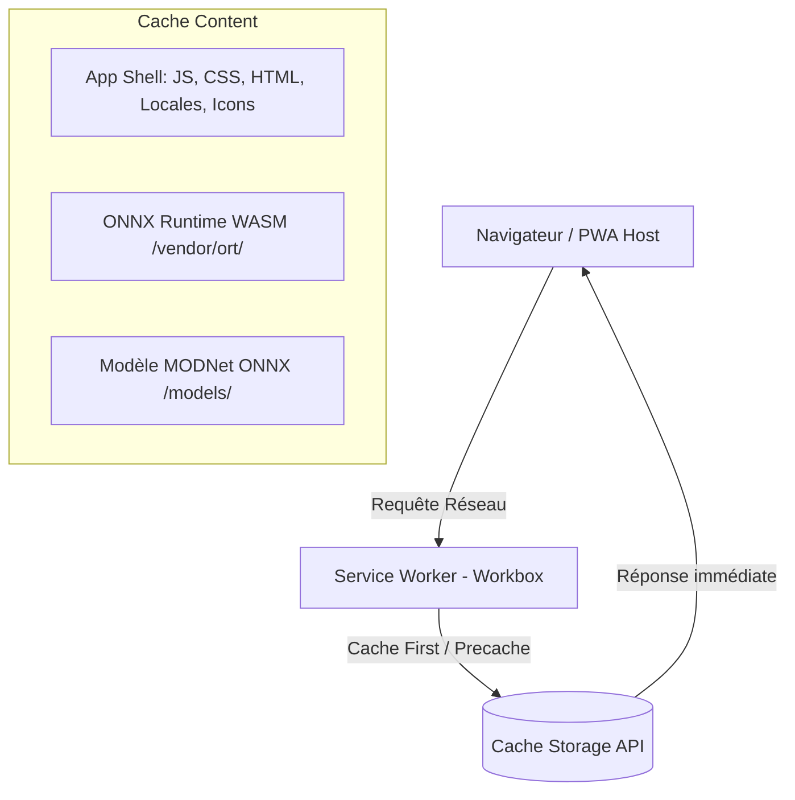

# Spécification Technique : Progressive Web App (PWA) & Support 100% Hors-Ligne

**Date** : 2026-11-08  
**Projet** : Nusuk Photo (`nusuk-photo`)  
**Statut** : Validé  

---

## 1. Contexte & Objectifs

Nusuk Photo est une application web cliente permettant le recadrage, le détourage IA et la mise en conformité de photos d'identité pour le portail Hajj/Omra Nusuk (480x640, fond blanc, < 1 Mo).

Les pèlerins et agences de voyage utilisent fréquemment l'application en déplacement ou dans des zones avec une connectivité internet instable ou absente. L'objectif de cette spécification est de transformer l'application en une Progressive Web App (PWA) complète et installable, capable de fonctionner à **100% hors-ligne**, y compris pour le détourage intelligent par IA (modèle ONNX et runtime WebAssembly).

### 1.1 Objectifs
- **Installabilité native** : Prise en charge des critères PWA modernes (Web App Manifest W3C, icônes adaptatives et masquables, mode d'affichage `standalone`).
- **Support hors-ligne complet (100% offline)** :
  - Mise en cache de l'App Shell (HTML, bundles JS/CSS, traductions i18n, icônes).
  - Pré-mise en cache et mise en cache d'exécution du runtime ONNX WebAssembly (`/vendor/ort/*`) et du modèle IA MODNet quantifié (`/models/modnet/*`).
- **Mises à jour transparentes en arrière-plan** : Utilisation du mode `autoUpdate` de Workbox pour recharger et activer immédiatement les nouvelles versions sans bloquer l'interface.
- **Zéro régression sur la suite de tests** et garantie de compilation stricte TypeScript (`tsc && vite build`).

### 1.2 Hors-champ (Non-goals)
- Aucun bouton personnalisé d'installation dans l'interface (l'installation repose sur l'invite native des navigateurs mobiles et desktop).
- Aucun système de synchronisation serveur en arrière-plan (l'application reste 100% locale et respectueuse de la vie privée).

---

## 2. Architecture & Composants



### 2.1 Dépendances
- `vite-plugin-pwa` (intégré dans `devDependencies`) : gère la génération du Service Worker, du Web App Manifest, et l'injection dans le flux de build de Vite.

### 2.2 Configuration Vite (`vite.config.ts`)
- Ajout de `VitePWA` configuré avec :
  - `registerType: 'autoUpdate'`
  - `includeAssets`: icônes SVG/PNG, polices, fichiers de locales (`locales/*.json`).
  - `manifest`: métadonnées de l'application et définition des icônes.
  - `workbox`:
    - `globPatterns`: `['**/*.{js,css,html,ico,png,svg,json,wasm,onnx}']`
    - `maximumFileSizeToCacheInBytes: 35 * 1024 * 1024` (35 Mo pour couvrir le binaire WASM de 26 Mo).
    - `runtimeCaching`:
      - Route `/models/**` avec stratégie `CacheFirst`, nom de cache `nusuk-models-cache`.
      - Route `/vendor/ort/**` avec stratégie `CacheFirst`, nom de cache `nusuk-ort-wasm-cache`.
      - Route `/locales/**` avec stratégie `StaleWhileRevalidate`, nom de cache `nusuk-locales-cache`.

---

## 3. Web App Manifest & Identité Visuelle

### 3.1 Propriétés du Manifest
- `id`: `/`
- `name`: `Nusuk Photo — Recadrage photo Hajj & Omra`
- `short_name`: `Nusuk Photo`
- `description`: `Recadrage et mise en conformité de photos d'identité pour le portail Hajj Nusuk (480x640, fond blanc, < 1 Mo).`
- `start_url`: `/`
- `scope`: `/`
- `display`: `standalone`
- `orientation`: `any`
- `theme_color`: `#006C35`
- `background_color`: `#F6F8F6`
- `categories`: `["productivity", "utilities", "photo"]`

### 3.2 Icônes
Les fichiers d'icônes seront générés dans `public/icons/` :
- `pwa-64x64.png` : 64 × 64 px
- `pwa-192x192.png` : 192 × 192 px (standard PWA)
- `pwa-512x512.png` : 512 × 512 px (splash screen & store)
- `maskable-icon-512x512.png` : 512 × 512 px (format masquable avec safe zone centrale de 80%)
- `apple-touch-icon-180x180.png` : 180 × 180 px (spécifique iOS Safari)
- `favicon.svg` : Favicon vectoriel moderne préservé

Design des icônes : fond émeraude `#006C35`, motif stylisé de la Kaaba (🕋) avec liseré or, assurant un rendu net et officiel.

### 3.3 Balises HTML (`index.html`)
- `<meta name="theme-color" content="#006C35" />`
- `<meta name="apple-mobile-web-app-capable" content="yes" />`
- `<meta name="apple-mobile-web-app-status-bar-style" content="default" />`
- `<link rel="apple-touch-icon" href="/icons/apple-touch-icon-180x180.png" />`

---

## 4. Cycle de Vie & Enregistrement du Service Worker

### 4.1 Enregistrement (`src/main.tsx`)
Enregistrement automatique au démarrage via le module virtuel `virtual:pwa-register` :
```typescript
import { registerSW } from 'virtual:pwa-register';

registerSW({
  immediate: true
});
```
Aucun prompt d'installation personnalisé n'est affiché dans l'interface conformément au choix utilisateur, et la mise à jour s'applique automatiquement au prochain chargement.

---

## 5. Prérequis de Compilation TypeScript

Avant le build final, correction du typage dans :
- `src/components/ActionBar.tsx`
- `src/components/SheetPreviewModal.tsx`
Remplacement de l'accès incorrect `.name` sur `SHEET_PRESETS` par un libellé formaté ou un lookup basé sur les dimensions réelles, permettant à `tsc && vite build` de réussir sans aucune erreur de compilation.

---

## 6. Stratégie de Tests & Validation

1. **Test unitaire du Manifest & des Assets PWA** (`tests/pwa.test.ts`) :
   - Vérifier la présence et les dimensions des icônes générées (`64x64`, `192x192`, `512x512`, `maskable`).
   - Vérifier la configuration du manifest (nom, couleurs, display, start_url).
2. **Test de build complet** :
   - Exécution de `npm run build` : confirmation de la génération de `dist/sw.js` et de la table de pré-cache Workbox contenant les fichiers `.wasm` et `.onnx`.
3. **Suite de tests de régression** :
   - Exécution complète de `npm test` (151 tests existants) pour garantir 100% de succès sans régression.
